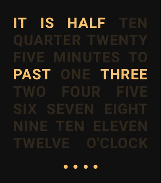
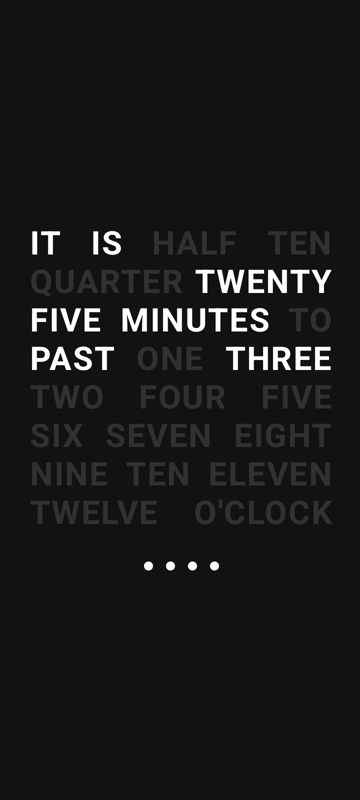
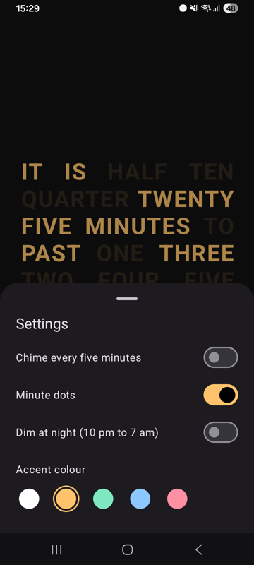
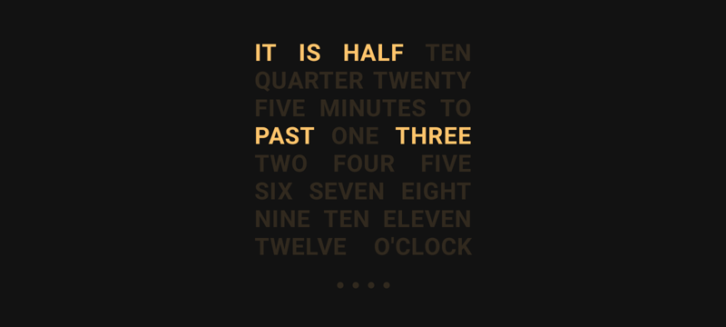

# Cool Word Clock

A minimal Android clock that tells the time in words.



## Features

- Time in words, in five-minute steps, with a soft fade between them
- Minute dots for the minutes in between
- Accent colours, optional five-minute chime, night dimming
- Full-screen and keeps the screen on, ideal for a desk or bedside stand
- Slow pixel drift to protect OLED screens

| Clock                                         | Settings                                         | Landscape                                         |
|-----------------------------------------------|--------------------------------------------------|---------------------------------------------------|
|  |  |  |

Tap anywhere to open settings.

## Build

Requires JDK 17+ and Android SDK 37.

```sh
./gradlew installDebug        # run on a connected device
./gradlew testDebugUnitTest   # unit tests
./gradlew assembleRelease     # minified release APK
```

## Project layout

```
app/src/main/java/com/sharmadhiraj/coolwordclock/
├── MainActivity.kt        full-screen host
├── ClockViewModel.kt      exposes settings
├── clock/WordClock.kt     time to words (pure, unit tested)
├── clock/MinuteTicker.kt  minute ticks while visible
├── data/                  settings model and DataStore
├── chime/Chime.kt         five-minute chime
└── ui/                    Compose screens
```
